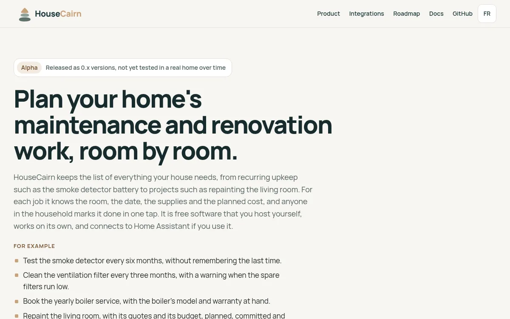

# housecairn.app

[](https://github.com/HouseCairn/website/actions/workflows/pages.yml?query=branch%3Amain)
[](LICENSE)
[](https://housecairn.app)

**Plan your home's maintenance and renovation work, room by room.**

[HouseCairn](https://github.com/HouseCairn/housecairn) keeps the list of everything your house needs, from recurring upkeep
such as the smoke detector battery to projects such as repainting the living
room. For each job it knows the room, the date, the supplies and the planned
cost, and anyone in the household marks it done in one tap. It is free software
that you host yourself, works on its own, and connects to Home Assistant if you
use it.

This repository is the public website of HouseCairn, <https://housecairn.app>:
English at `/`, French at `/fr/`.



For example:

- test the smoke detector every six months, without remembering the last time;
- clean the ventilation filter every three months, with a warning when the
  spare filters run low;
- book the yearly boiler service, with the boiler's model and warranty at hand;
- repaint the living room, with its quotes and its budget, planned, committed
  and paid.

Static site built with [Astro](https://astro.build). No JavaScript in the browser, no
cookies, no analytics and no external resources: the Manrope font is self-hosted
(one variable file, Latin subset).

## The HouseCairn repositories

- [housecairn](https://github.com/HouseCairn/housecairn): the web application, to install first.
- [home-assistant-addons](https://github.com/HouseCairn/home-assistant-addons): HouseCairn as a Home Assistant app (add-on).
- [home-assistant-housecairn](https://github.com/HouseCairn/home-assistant-housecairn): the Home Assistant integration (HACS).
- [housecairn-mobile](https://github.com/HouseCairn/housecairn-mobile): the phone app for iOS and Android, in development, not on the stores yet.
- [website](https://github.com/HouseCairn/website): the site <https://housecairn.app> (this repository).

Website: <https://housecairn.app>. Documentation, in English and French:
<https://docs.housecairn.app>.


## Build and preview

Node.js 22.23.4 or newer (CI uses Node 24).

```sh
npm ci              # exact versions from package-lock.json
npm run build       # checks the design tokens, then writes the static site to dist/
npm run preview     # serves dist/ on http://localhost:4321
npm run check       # strict-CSP output, no JavaScript, weight budget
npm run lighthouse  # Lighthouse, home page in both languages, mobile and desktop
```

Set `ASTRO_TELEMETRY_DISABLED=1` to turn off Astro's own build telemetry. `npm run
lighthouse` needs Chrome (found automatically, or set `CHROME_PATH`).

## Structure

| Path | Content |
| --- | --- |
| `src/i18n/ui.ts` | All page text, English and French, same keys |
| `src/components/Home.astro`, `Roadmap.astro`, `Steps.astro`, `Video.astro` | Page bodies, shared by both languages |
| `src/components/Shot.astro` | A screenshot in a browser or phone frame: AVIF and WebP, declared dimensions |
| `src/assets/app/` | Real application screenshots, English and French |
| `src/styles/` | `tokens.css` (generated), `font.css`, `global.css` |
| `design/tokens.json` | Copy of the application's design tokens |
| `src/pages/` | Routes: `/`, `/roadmap/`, `/video/`, `/fr/`, `/fr/roadmap/`, `/fr/video/`, `/404.html` |
| `public/media/` | The video tour: one MP4 per language of the screens, both with English and French subtitle tracks, the WebVTT files and the posters |
| `public/` | Logo, favicons, Open Graph images, `robots.txt` |
| `scripts/` | Tokens, checks, Lighthouse, Open Graph images |

## Rules for the content

- **Only what exists.** Every feature named on the site exists on the `main` branch of
  the application; check its code or documentation before adding one. Integrations carry
  their real state (available, partial, planned). Released versions are alpha: the site
  says so.
- **One message.** The headline, the paragraph and the examples of the first section are
  those of the [message](https://docs.housecairn.app/developer/message/) of the
  application's documentation; change them there first.
- **Real screenshots only.** Nothing is drawn or simulated. Screenshots use the fictional
  demo home of the application, in the page's language.
- **Same colours as the application.** `npm run tokens` writes `src/styles/tokens.css` from
  `design/tokens.json`, a copy of the application's file. The build fails if the CSS is out
  of date, and CI fails if the copy differs from the application's `main`.

## Application screenshots

1. Run a local instance of the application (its `CONTRIBUTING.md`, Local development).
2. Create two accounts, then add the demo home to each:
   `manage.py load_demo_data --owner <e-mail> --language en`, and the same with `fr`.
3. Sign in with each account, browser language set to match, and capture Today, Projects
   and Rooms at 390 x 844 (phone) and Today at 1280 x 800 (desktop), at device scale 2.
4. Check that nothing real is visible, then replace the files in `src/assets/app/`
   (`today-phone`, `today-desktop`, `projects-phone`, `rooms-phone`, `.en.png` and
   `.fr.png`). The build converts them to AVIF and WebP.
5. The section "How it's used" follows the two examples of the demo home (the descaling of
   the espresso machine, the bathroom project). Its phone captures (`usage-descaling-phone`,
   `usage-stock-phone`, `usage-bathroom-phone`) are taken after marking *Descaling* done
   once, so that the stock shows one filter left, marked low.

## Video tour

`/video/` and `/fr/video/` play an 81-second tour without sound, made from real captures of
the demo home with zooms, highlights and fades, in the colours and the font of the
application. The home page only links to it, with a lazy-loaded poster: the video is
outside the weight budget and the browser fetches it only when the visitor presses play
(`preload="none"`). Each MP4 carries both subtitle tracks, the page's language first.

## Checks in CI

`.github/workflows/ci.yml` runs on every pull request:

- the design tokens match the application's `main`;
- the build;
- `npm run check`: no inline `<style>`, no `style=` attribute, no script other than the
  JSON-LD block, no `data:` URI, no resource from another site, no JavaScript file, and the
  budget of the home page (HTML 20 KB and CSS 12 KB compressed, one font file of 30 KB at most);
- `npm run lighthouse`: 100 in SEO and accessibility, at least 95 in the other categories,
  mobile and desktop, English and French, at most 200 KB transferred on mobile and no JavaScript.
  A first run of the home page, not counted, warms up Chrome.

## Content Security Policy

The output works under a strict CSP: stylesheets are files (`build.inlineStylesheets:
"never"`), assets are never inlined (`vite.build.assetsInlineLimit: 0`), and the only inline
script is JSON-LD. A matching policy, for a host that lets you set headers (GitHub Pages
does not):

```
default-src 'none'; style-src 'self'; font-src 'self'; img-src 'self'; media-src 'self';
base-uri 'none'; form-action 'none'; frame-ancestors 'none'
```

## Deployment

`.github/workflows/pages.yml` builds the site and deploys it to GitHub Pages on every push
to `main`. The custom domain `housecairn.app` is a repository setting (Settings, Pages),
not set by the workflow.

## Licence

AGPL-3.0-only, like the application. HouseCairn, by Robvred.
