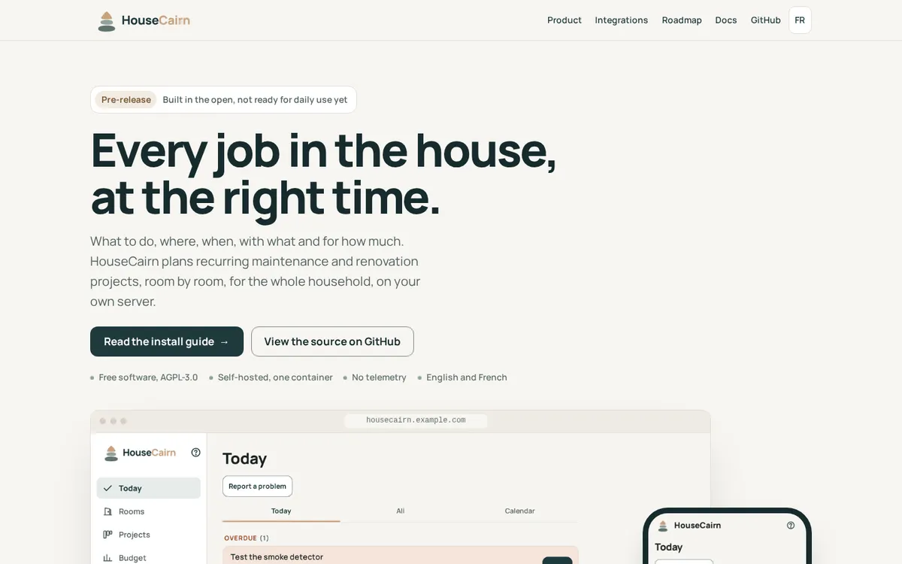

# housecairn.app

The public website of [HouseCairn](https://github.com/HouseCairn/housecairn), a free,
self-hosted web app for home maintenance and renovation. English at `/`, French at `/fr/`.



Static site built with [Astro](https://astro.build). No JavaScript in the browser, no
cookies, no analytics and no external resources: the Manrope font is self-hosted
(one variable file, Latin subset).

## Build and preview

Node.js 22.23.4 or newer (CI uses Node 24).

```sh
npm ci              # exact versions from package-lock.json
npm run build       # checks the design tokens, then writes the static site to dist/
npm run preview     # serves dist/ on http://localhost:4321
npm run check       # strict-CSP output, no JavaScript, weight budget
npm run lighthouse  # Lighthouse, home page in both languages, mobile and desktop
```

Set `ASTRO_TELEMETRY_DISABLED=1` to turn off Astro's own build telemetry. `npm run
lighthouse` needs Chrome (found automatically, or set `CHROME_PATH`).

## Structure

| Path | Content |
| --- | --- |
| `src/i18n/ui.ts` | All page text, English and French, same keys |
| `src/components/Home.astro`, `Roadmap.astro`, `Steps.astro` | Page bodies, shared by both languages |
| `src/components/Shot.astro` | A screenshot in a browser or phone frame: AVIF and WebP, declared dimensions |
| `src/assets/app/` | Real application screenshots, English and French |
| `src/styles/` | `tokens.css` (generated), `font.css`, `global.css` |
| `design/tokens.json` | Copy of the application's design tokens |
| `src/pages/` | Routes: `/`, `/roadmap/`, `/fr/`, `/fr/roadmap/`, `/404.html` |
| `public/` | Logo, favicons, Open Graph images, `robots.txt` |
| `scripts/` | Tokens, checks, Lighthouse, Open Graph images |

## Rules for the content

- **Only what exists.** Every feature named on the site exists on the `main` branch of
  the application; check its code or documentation before adding one. Integrations carry
  their real state (available, partial, planned). No version has been released yet: the
  site says so.
- **Real screenshots only.** Nothing is drawn or simulated. Screenshots use the fictional
  demo home of the application, in the page's language.
- **Same colours as the application.** `npm run tokens` writes `src/styles/tokens.css` from
  `design/tokens.json`, a copy of the application's file. The build fails if the CSS is out
  of date, and CI fails if the copy differs from the application's `main`.

## Application screenshots

1. Run a local instance of the application (its `CONTRIBUTING.md`, Local development).
2. Create two accounts, then add the demo home to each:
   `manage.py load_demo_data --owner <e-mail> --language en`, and the same with `fr`.
3. Sign in with each account, browser language set to match, and capture Today, Projects
   and Rooms at 390 x 844 (phone) and Today at 1280 x 800 (desktop), at device scale 2.
4. Check that nothing real is visible, then replace the files in `src/assets/app/`
   (`today-phone`, `today-desktop`, `projects-phone`, `rooms-phone`, `.en.png` and
   `.fr.png`). The build converts them to AVIF and WebP.

## Checks in CI

`.github/workflows/ci.yml` runs on every pull request:

- the design tokens match the application's `main`;
- the build;
- `npm run check`: no inline `<style>`, no `style=` attribute, no script other than the
  JSON-LD block, no `data:` URI, no resource from another site, no JavaScript file, and the
  budget of the home page (HTML 20 KB and CSS 12 KB compressed, one font file of 30 KB at most);
- `npm run lighthouse`: at least 95 in every category, mobile and desktop, English and
  French, at most 200 KB transferred on mobile and no JavaScript.

## Content Security Policy

The output works under a strict CSP: stylesheets are files (`build.inlineStylesheets:
"never"`), assets are never inlined (`vite.build.assetsInlineLimit: 0`), and the only inline
script is JSON-LD. A matching policy, for a host that lets you set headers (GitHub Pages
does not):

```
default-src 'none'; style-src 'self'; font-src 'self'; img-src 'self';
base-uri 'none'; form-action 'none'; frame-ancestors 'none'
```

## Deployment

`.github/workflows/pages.yml` builds the site and deploys it to GitHub Pages on every push
to `main`, with the custom domain `housecairn.app`.

## Licence

AGPL-3.0-only, like the application. HouseCairn, by Robvred.
